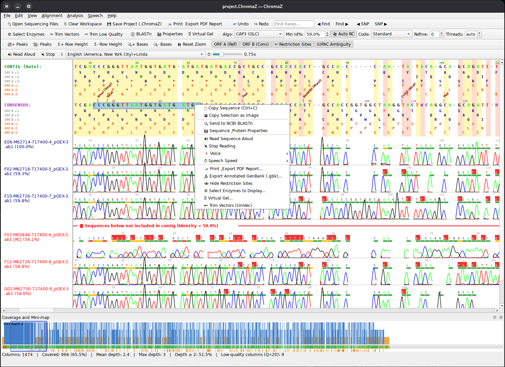

# ChromaZ — Contig Alignment Viewer & Chromatogram Editor


**Языки: [English](README.md) | [Русский](README_RU.md)**

**ChromaZ** — это кроссплатформенное десктопное C++/Qt6 приложение для сборки контигов, визуализации хроматограмм Sanger-секвенирования, многостороннего выравнивания, рестрикционного анализа и биоинформатической обработки нуклеотидных и аминокислотных последовательностей.

---

## Интерфейс



---

## 📥 Скачивание и быстрая установка

Готовые установочные пакеты доступны на странице [Releases](https://github.com/zajakin/ChromaZ/releases/latest/):

* **Debian / Ubuntu**: [Скачать ChromaZ_Linux_Install_VERSION_amd64.deb](https://github.com/zajakin/ChromaZ/releases/latest/)
* **Windows**: [Скачать ChromaZ_Windows_Install_VERSION.exe](https://github.com/zajakin/ChromaZ/releases/latest/)
* **macOS**: [Скачать ChromaZ_macOS_Install_VERSION.dmg](https://github.com/zajakin/ChromaZ/releases/latest/) (универсальный бинарник Apple Silicon + Intel)

---

## 🌟 Основные возможности

### 🧬 Сборка контигов и алгоритмы выравнивания
* **7+ независимых алгоритмов выравнивания**:
  * **OLC / CAP3 (Sanger Default)** — сборка перекрытий в стиле Vector NTI ContigExpress без штрафов за 5'/3'-выступающие фланги.
  * **Affine-Gap Block (Gotoh)** — полуглобальное выравнивание с раздельными штрафами за открытие и продолжение гэпов.
  * **Needleman-Wunsch** — строгое глобальное выравнивание.
  * **Smith-Waterman** — локальное выравнивание с выделением областей максимального совпадения.
  * **BLAST (Seed & Extend)** — ускоренный поиск по $k$-мерам с расширением вдоль оптимальной диагонали.
  * **Banded DP** — полосовое динамическое программирование для длинных прочтений.
  * **Wavefront Alignment (WFA)** — пошаговое поволновое расширение фронта ошибок.
  * **Clustal-style прогрессивное MSA** — матрица расстояний по k-мерам → направляющее дерево UPGMA → попрофильное выравнивание всех ридов вместе с референсом (без внешних утилит).
* **Автоматический контиг и референс**: Автоматический выбор затравки (seed) — самого длинного прочтения или загрузка собственного референсного FASTA/GenBank файла.
* **Фоновое многопоточное выравнивание**: риды выравниваются параллельно на всех ядрах в рабочем потоке; интерфейс остаётся отзывчивым, есть индикатор прогресса и кнопка *Cancel*.
* **Уточнение консенсуса**: необязательные раунды (*Refine* на панели) перевыравнивают все риды к консенсусу предыдущего раунда.
* **Авто-ориентация цепей (Auto RC)**: Автоматическое определение и перевод комплементарных прочтений в прямую цепь (`[RC]`) с возможностью ручного переключения.

---

### 📈 Анализ хроматограмм и качество (Phred)
* **Миникарта покрытия**: закрепляемая панель с глубиной покрытия вдоль контига, полосой качества Phred (зелёный/жёлтый/красный), отметками SNP и видимой областью; клик или перетаскивание — навигация. Статистика: покрытые колонки, средняя/максимальная глубина, низкокачественные колонки.
* **Четырехцветный график хроматограмм**: Отрисовка пиков Sanger-следов (A — зеленый, C — синий, G — черный/желтый, T — красный) для файлов `.ab1` и `.scf`.
* **Phred Quality Scores**: Цветовая индикация качества каждого нуклеотида (зеленый $Q \ge 30$, желтый $Q \ge 20$, красный $Q < 20$).
* **Авто-тримминг по качеству (Trim Low QC)**: Удаление низкокачественных флангов на основе Phred-оценок с настраиваемым порогом.
* **Нумерация координат нуклеотидов**: Отрисовка 1-based линейки координат над каждым прочтением, консенсусом и референсом (без учета гэпов).

---

### ✂️ Рестрикционный анализ и векторный тримминг
* **Интеграция базы данных REBASE**: Поддержка коммерческой базы эндонуклеаз рестрикции REBASE (`bionetc.txt`, около 800 ферментов) с автоматическим скачиванием при сборке и резервным чтением из ресурсов Qt.
* **Выбор ферментов**: фильтруемый список ферментов для отображения (выбор запоминается между запусками); сайты нескольких ферментов в одной позиции объединяются в одну подпись.
* **Виртуальный гель**: *Analysis → Virtual Gel…* моделирует агарозный гель консенсуса после рестрикции выбранными ферментами (линейная или кольцевая молекула, дорожка без рестрикции, маркер длин, таблица фрагментов, экспорт PNG). Ферменты, отмеченные в *Select Enzymes to Display*, выбираются по умолчанию.
* **Визуализация сайтов гидролиза**: Отрисовка засечек разреза и названий ферментов над консенсусом с поддержкой вырожденных IUPAC-символов и ферментов типа IIS со смещенным разрезом (например, BsaI).
* **Векторный тримминг по UniVec**: Быстрое удаление векторных остатков, праймеров и адаптеров (M13, T7, SP6 и др.) с концов прочтений в один клик.

---

### 🔊 Голосовая диктовка (Text-to-Speech)
* **Чтение последовательности голосом**: Воспроизведение выделенного участка последовательности через нативный речевой синтезатор ОС (`Qt6::TextToSpeech`).
* **Контроль скорости**: Регулировка скорости диктовки (0.5x, 1.0x, 1.5x) в контекстном меню с разделением букв паузами для удобной сверки с внешними источниками без отрыва взгляда.

---

### 🔬 Молекулярно-биологические и ПЦР утилиты
* **Расчет температуры плавления ($T_m$) для ПЦР**: окно *Properties* сразу показывает GC-состав, $T_m$ по правилу Уоллеса и по GC-формуле; после ввода концентраций Na⁺/Mg²⁺ и праймера добавляется $T_m$ по методу ближайших соседей (SantaLucia 1998) с ΔH, ΔS и ΔG.
* **Отправка в NCBI BLASTn в один клик**: Мгновенный запуск поиска гомологии в веб-сервисе NCBI BLAST прямо из контекстного меню программы.
* **Физико-химические графики и свойства белка**:
  * **GC-профиль**: Интерактивный график доли GC в скользящем окне вдоль последовательности.
  * **Гидрофобность Kyte-Doolittle**: Профиль гидрофобности транслированного пептида.
  * **Молекулярная масса**: Расчет молекулярной массы пептида (Да) с компенсацией отщепления молекул воды.

---

### 🧪 Трансляция и 6 рамок считывания (ORF)
* **6 рамок считывания**: Вычисление и отображение прямых (+1, +2, +3) и обратных (-1, -2, -3) рамок считывания для кодирующих белки областей.
* **Раздельное управление кнопками `ORF A` и `ORF B`**:
  * **ORF A**: переключатель показа 6 рамок считывания для референса / авто-контига.
  * **ORF B**: переключатель показа 6 рамок считывания для консенсусной последовательности.
* **Таблицы генетического кода**: Поддержка стандартного кодового стола (Standard Human), позвоночного митохондриального (Vertebrate Mitochondrial) и бактериального/пластидного (Bacterial/Plant Plastid).
* **IUPAC Консенсус**: Расчет неоднозначных нуклеотидов (R, Y, S, W, K, M) при несовпадении оснований в контиге.

---

### ✍️ Интерактивное редактирование и навигация
* **Редактирование с клавиатуры**: Прямая замена нуклеотидов (A, C, G, T, N, `-`), вставка и удаление символов с авто-пересчетом координат хроматограммы.
* **Полный Undo / Redo**: История отмены и повтора действий (`Ctrl+Z` / `Ctrl+Y` или `Ctrl+Shift+Z`) до 100 шагов.
* **SNP Навигация**: Автоматическое нахождение полиморфизмов (SNP) и быстрый переход по кнопкам `◀ SNP` / `SNP ▶`.
* **Быстрый поиск**: Поиск подстрок нуклеотидов с подсветкой и автоматической прокруткой; поле поиска на панели с кнопками *Find ◀ / ▶*.
* **Удалённые основания**: удалённое основание (вместе с данными хроматограммы и качества) остаётся в риде, показывается пустым слотом, возвращается вводом буквы и сохраняется при перевыравнивании (колонка-гэп добавляется только при необходимости). Окончательно основания удаляются лишь тримингом концов.
* **Недавние файлы и автосохранение**: *File → Open Recent*; сессия автосохраняется каждые 2 минуты и восстанавливается после сбоя; при выходе подтверждаются несохранённые изменения.
* **Сохранение настроек**: раскладка окна, алгоритм, порог идентичности, генетический код, переключатели ORF/рестрикции/IUPAC и параметры озвучки восстанавливаются при запуске.
* **Очистка рабочей области**: сброс всех загруженных треков в один клик.
* **Drag & Drop**: Изменение порядка треков мышью и перетаскивание файлов прямо в окно программы.

---

### 📄 Экспорт, печать и проекты
* **Прямая печать (Print Dialog)**: Отправка отчетов выравнивания на физический или виртуальный принтер через нативный диалог печати ОС (`Qt6::PrintSupport`).
* **Экспорт в GenBank (.gbk)**: Выгрузка аннотированного файла с блоками `LOCUS`, `FEATURES` (сайты рестрикции) и блоком `ORIGIN`.
* **Копирование графика в буфер**: Копирование выделенного участка выравнивания вместе с пиками хроматограммы в буфер обмена как PNG (`Copy Selection as Image`).
* **Экспорт в FASTA**: Сохранение сформированного консенсуса.
* **Экспорт в PDF**: Генерация многостраничного PDF-отчета с настраиваемым количеством нуклеотидов на строку.
* **Экспорт PNG**: Сохранение текущего графического вида выравнивания.
* **Проекты `.ChromaZ`**: Сохранение и загрузка состояния работы (прочтения, хроматограммы, ориентации, гэпы и правки) в JSON-формате.

---

## 📁 Поддерживаемые форматы файлов

| Формат | Расширение | Описание |
| :--- | :--- | :--- |
| **ABI Chromatogram** | `.ab1` | Прочтение + хроматограмма + Phred QC |
| **Staden SCF (v2/v3)** | `.scf` | Прочтение + хроматограмма + Phred QC |
| **FASTA / GenBank** | `.fasta`, `.fa`, `.gb`, `.gbk` | Референс или мульти-записные прочтения |
| **FASTQ** | `.fastq`, `.fq` | Прочтения + Phred QC |
| **Plain Text** | `.txt` | Нуклеотидные строки |
| **GenBank Export** | `.gbk` | Аннотированный консенсус с таблицей фичей |
| **ChromaZ Project** | `.ChromaZ` | Полный проект сборки |

---

## 🎹 Горячие клавиши и действия

| Сочетание / Действие | Назначение |
| :--- | :--- |
| **Ctrl + O** | Открыть файлы секвенирования (AB1/SCF/FASTA/GenBank/FASTQ/TXT); проекты — *File → Open Project* |
| **Ctrl + S** | Сохранить проект `.ChromaZ` |
| **Ctrl + Z** | Отменить действие (Undo) |
| **Ctrl + Y** / **Ctrl + Shift + Z** | Повторить действие (Redo) |
| **Ctrl + C** | Скопировать выделенную последовательность (DNA/ORF) |
| **Ctrl + F** | Поиск последовательности |
| **Ctrl + Колесо мыши** | Масштабирование по оси Y (высота пиков) |
| **Колесо мыши** | Масштабирование по оси X (ширина оснований) |
| **Правый клик мыши** | Меню: BLASTn, свойства и графики (вкл. $T_m$), диктовка TTS, экспорт, выбор ферментов |

## ⌨ Параметры командной строки

```
ChromaZ [параметры] [файлы...]
```
Файлы и параметры применяются сразу после запуска (справка также в программе: **Help → Command-line options…**).

| Параметр | Описание |
| :--- | :--- |
| `файлы...` | Файлы секвенирования (`.ab1 .scf .fasta .fa .gb .gbk .fastq .fq .txt`) и/или проект `.ChromaZ` |
| `-p, --project <файл>` | Открыть проект `.ChromaZ` |
| `-r, --reference <файл>` | Взять первую запись FASTA/GenBank как референс |
| `-a, --algorithm <имя>` | `cap3` (по умолчанию), `gotoh`, `nw`, `sw`, `blast`, `banded`, `wfa`, `clustal` (прогрессивное MSA) или `0`–`7` |
| `-i, --min-identity <процент>` | Минимальная идентичность рида для включения в контиг (по умолчанию 45) |
| `-t, --table <имя>` | Генетический код: `standard`, `mito`, `bacterial` (или `0`–`2`) |
| `--no-auto-rc` | Отключить автоопределение обратного комплемента |
| `--iupac` | IUPAC-коды в консенсусе |
| `--refine <n>` | Раундов уточнения консенсуса (0–10, по умолчанию 0) |
| `--threads <n>` | Потоки выравнивания (0 = автоматически) |
| `--no-orf-a`, `--no-orf-b` | Скрыть 6 рамок считывания референса / консенсуса |
| `--restriction` | Показать сайты рестрикции |
| `--trim-quality <phred>` | Обрезать концы ридов низкого качества после выравнивания |
| `--trim-vectors` | Обрезать векторные последовательности и праймеры с концов ридов |
| `--export-fasta`, `--export-gbk`, `--export-png`, `--export-pdf <файл>` | Записать консенсус / вид / отчёт |
| `--pdf-bases <n>` | Нуклеотидов на строку в PDF (по умолчанию 60) |
| `--save-project <файл>` | Сохранить итоговый проект |
| `--quit` | Выйти после выполнения шагов (пакетный режим; без дисплея используйте `QT_QPA_PLATFORM=offscreen`) |
| `-h, --help`, `-v, --version` | Справка / версия |

Параметры командной строки не меняют сохранённые настройки. Примеры:
```bash
ChromaZ read1.ab1 read2.ab1 --algorithm clustal --refine 2
ChromaZ -p sample.ChromaZ --export-fasta consensus.fasta --quit
ChromaZ reads/*.ab1 -r plasmid.gb --trim-quality 20 --trim-vectors --export-pdf report.pdf --quit
```

---

## 🛠 Сборка и компиляция

### Требования
* Компилятор C++17 (GCC 11+, Clang 14+, MSVC 2019+)
* CMake 3.16+
* Модули Qt 6.x: `Core`, `Gui`, `Widgets`, `Test`, `TextToSpeech`, `PrintSupport`

### Сборка под Linux (Debian Trixie / Ubuntu 24.04+)
```bash
git clone https://github.com/zajakin/ChromaZ.git
cd ChromaZ
cmake -B build -S src -DCMAKE_BUILD_TYPE=Release
cmake --build build -j$(nproc)
./build/ChromaZ
```

### Тесты и подписанные релизы (CI)
* Модульные тесты (`ctest`) запускаются в Linux, Windows и macOS при каждом push и pull request: разбор SCF v2/v3 и GenBank, выравнивание (включая сохранение удалённых оснований), прогрессивное MSA, уточнение консенсуса, расчёты Tm и виртуального геля.
* Релиз создаётся один раз после успешной сборки всех трёх платформ вместе с `SHA256SUMS.txt`.
* Установщики подписываются автоматически, если заданы секреты репозитория (иначе собираются неподписанные):
  * **Windows** — `WIN_CERT_PFX_BASE64` (base64 сертификата подписи кода `.pfx`), `WIN_CERT_PASSWORD`
  * **macOS** — `MACOS_CERT_P12_BASE64` (сертификат Developer ID Application, base64 `.p12`), `MACOS_CERT_PASSWORD`, `MACOS_SIGN_IDENTITY` (например, `Developer ID Application: Name (TEAMID)`)
  * **Нотаризация macOS** — `APPLE_ID`, `APPLE_TEAM_ID`, `APPLE_APP_PASSWORD` (пароль приложения); DMG нотаризуется и «степлится».

---

## 📜 Лицензия
Проект распространяется под лицензией MIT. Подробная информация находится в файле LICENSE.
